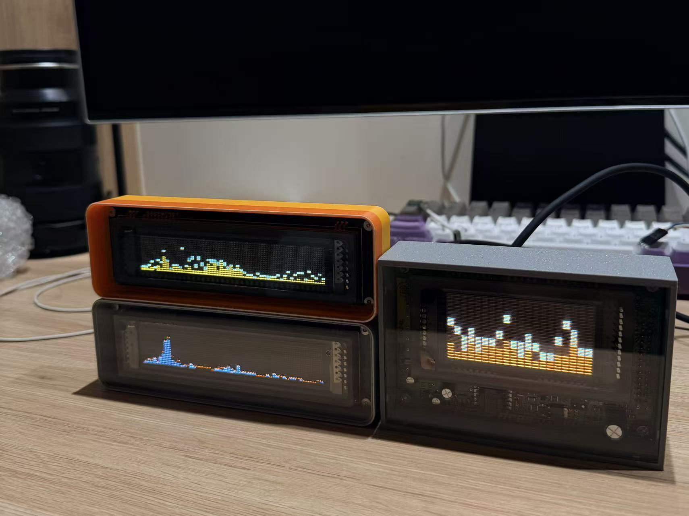

---

# VFD 多功能显示系统 使用说明书



---

# 一、设备简介

感谢您使用本产品。

本设备采用 **高亮双色 VFD 显示屏** 设计，支持：

* 时钟显示
* 音频频谱
* 动画效果
* 贪吃蛇游戏
* 自动节能熄屏

设备仅使用 **两个物理按键** 即可完成全部操作。

---

# 二、按键说明

设备共有 **2 个按键**：

| 按键 | 短按        | 长按（约1秒） |
| -- | --------- | ------- |
| 上键 | 确认 / 进入菜单 | 退出 / 返回 |
| 下键 | 切换 / 向下选择 | 向上选择    |

说明：

* **短按**：快速按一下
* **长按**：按住约 1 秒

---

# 三、主界面功能

开机后会进入 **默认显示模式**（可在设置中修改）。

系统包含以下模式：

1. 时钟模式
2. 音频频谱
3. 贪吃蛇
4. 动画效果
5. 系统菜单

---

# 四、模式切换

在主界面：

| 操作   | 功能       |
| ---- | -------- |
| 下键短按 | 切换到下一个模式 |
| 下键长按 | 切换到上一个模式 |
| 上键短按 | 进入菜单     |
| 上键长按 | 切换当前模式主题 |

---

# 五、各模式说明

---

# 1 时钟模式


功能：

* 显示当前时间
* 显示日期
* 支持多种显示风格

操作：

```
上键长按：切换时钟主题
```

---

# 2 音频频谱模式


功能：

* 实时显示音乐频谱
* 支持 **12 种颜色主题**

操作：

```
上键长按：切换频谱主题
```

---

# 3 贪吃蛇模式


功能：

* 自动运行
* 可改变蛇的粗细

操作：

```
上键长按：切换蛇身宽度
```

---

# 4 动画模式


支持动画：

* Mind
* Circle
* Snowflake
* Planet
* Triangle
* Starwar
* Firework

可以在菜单中开启或关闭。

---

# 六、系统菜单

进入方式：

```
主界面 → 上键短按
```

菜单结构：

```
Sensor
Animation
Setting
Diagnostic
About
```

---

# 1 Sensor（传感器页面）

显示：

* 日期
* 时间
* 星期

---

# 2 Animation（动画设置）


可以单独开启或关闭动画：

```
Mind
Circle
Snowflake
Planet
Triangle
Starwar
Firework
```

操作：

| 操作 | 功能 |
| -- | -- |
| 下键 | 选择 |
| 上键 | 开关 |

---

# 3 Setting（系统设置）


包含：

```
Set Time
FFT Theme
Clock Theme
Default Func
Clock Dimming
Screen ON
Screen OFF
```

---

## 设置时间

可以依次设置：

```
年
月
日
星期
小时
分钟
```

操作：

| 操作   | 功能   |
| ---- | ---- |
| 下键   | 调整数值 |
| 上键短按 | 下一项  |
| 上键长按 | 退出   |

---

## 默认模式

可以设置开机默认进入：

```
Clock
FFT
Snake
Motion
```

---

# 七、自动熄屏功能

设备支持 **定时自动关闭屏幕**。

可以在菜单中设置：

```
Screen ON
Screen OFF
```

示例：

```
Screen ON  = 07
Screen OFF = 23
```

表示：

```
07:00 自动亮屏
23:00 自动关闭
```

---

# 八、夜间唤醒功能

当屏幕处于自动关闭状态时：

```
按任意按键
```

屏幕将 **临时点亮 10 秒**。

10 秒后自动再次关闭。

如果继续操作：

```
唤醒时间会重新计时
```

---

# 九、Diagnostic（屏幕测试）


用于测试屏幕：

测试模式包括：

* 蓝色呼吸
* 红色呼吸
* 灰度测试
* 棋盘灰度
* 火焰动画
* 渐变流光

操作：

```
上下键切换测试模式
```

---

# 十、About（关于）

显示：

```
Author
Version
Build Date
```

---

# 十一、自动保存

所有设置 **自动保存到 Flash**：

```
修改后自动保存
断电不会丢失
无需手动保存
```

---

# 十二、菜单自动退出

如果 **10 秒没有操作**：

```
菜单会自动退出
返回主界面
```

---

# 十三、常见问题

### Q：屏幕晚上为什么会自动关闭？

设备启用了 **自动熄屏功能**。

可以在：

```
Setting → Screen ON / Screen OFF
```

进行调整。

---

### Q：晚上如何临时查看屏幕？

按任意按键即可 **点亮 10 秒**。

---

### Q：断电时间会丢失吗？

不会。

设备使用 **RX8900 RTC 时钟芯片**。

---

# 十四、技术参数

| 项目   | 参数      |
| ---- | ------- |
| 显示屏  | VFD双色点阵 |
| 控制方式 | 双按键     |
| RTC  | RX8900  |
| 自动保存 | Flash   |
| 动画数量 | 多种      |

---
